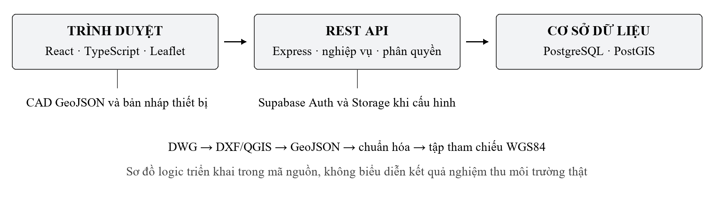

# Báo cáo tiến độ đồ án tốt nghiệp

XÂY DỰNG HỆ THỐNG WEBGIS HỖ TRỢ QUẢN LÝ HẠ TẦNG VÀ THEO DÕI SỰ CỐ CẤP NƯỚC

Sinh viên: Nguyễn Hoàng Tuấn
Mã số sinh viên: 1150070049
Lớp: 11_TTMT
Giảng viên hướng dẫn: ThS. Từ Thanh Trí
Khoa Công nghệ Thông tin
Trường Đại học Tài nguyên và Môi trường TP. Hồ Chí Minh
Kỳ báo cáo: 19/10/2026 đến 25/10/2026
Ngày chốt tiến độ: 25/10/2026

<!-- page -->

## 1 Kết quả chính và đánh giá tiến độ

Đến ngày 25/10/2026, em đã tích hợp các phân hệ bản đồ, quản lý tài sản, tiếp nhận và theo dõi sự cố, phân quyền ở backend, thống kê và báo cáo vào hệ thống WebGIS. Mã nguồn hiện được lưu trên GitHub và có hướng dẫn cài đặt, migration CSDL, nạp dữ liệu mẫu và các lệnh kiểm tra tái lập. Trọng tâm kỳ báo cáo là hoàn thiện luồng nghiệp vụ, giảm tải khởi tạo, bổ sung chất lượng hồ sơ và làm rõ phạm vi số liệu báo cáo.

Kết quả kiểm tra tự động ngày 25/10 gồm 100 test đạt trên 11 tệp kiểm thử. Lint và build của frontend/backend đều thành công; kiểm tra CAD Vector và đối soát CRS bằng script cũng thành công. Các test API trong đợt này sử dụng CSDL giả lập. Những kết quả này xác nhận các trường hợp đã kiểm thử, chưa thay thế nghiệm thu PostgreSQL/PostGIS, Supabase và thiết bị thực địa.

| Nội dung | Kết quả có thể kiểm tra |
| --- | --- |
| Mã nguồn chốt kỳ báo cáo | Commit 2abe34e trên nhánh main, repository công khai |
| Dữ liệu CAD chuẩn hóa | 21.272 feature, 162 CAD layer |
| Dữ liệu dùng cho CAD Web | 9.395 feature, khoảng 21,02 MB trước nén |
| Bản xuất WGS84 tham chiếu | 1.846 feature, khoảng 3,97 MB trước nén |
| Nhóm dữ liệu của script seed | 3 nhà máy và 416 tuyến ống; chưa phải số lượng nghiệm thu CSDL hiện thời |
| Kiểm tra tự động | 100/100 test; 7 nhóm lệnh kiểm tra đều trả mã kết thúc 0 |

Em tự đánh giá tiến độ ở mức **nguy cơ chậm so với đề cương**. Các chức năng nghiệp vụ đã có bước tiến rõ, nhưng thu nhận GPS thực địa, truy vấn bán kính WGS84, nghiệm thu phân quyền trên môi trường thật và bằng chứng đo hiệu năng còn cần hoàn thiện. Lịch viết các chương báo cáo trong đề cương cũng cần đẩy sớm để phù hợp hạn nộp file ngày 22/11/2026.

Minh chứng chính là mã nguồn tại https://github.com/tunas184626/DATN_NguyenHoangTuan_1150070049_TTMT và nhật ký `minh_chung/kiem_tra_2026-10-25.txt` đi kèm báo cáo.

<!-- page -->

## 2 Đối chiếu với đề cương đã cung cấp

Đề tài giữ mục tiêu xây dựng hệ thống quản lý nghiệp vụ gắn với dữ liệu không gian, kế thừa bộ dữ liệu CAD/GIS từ giai đoạn thực tập. Bảng dưới đối chiếu phạm vi đề cương với phiên bản mã nguồn hiện tại. Trạng thái “đã có mã” chỉ phản ánh phần triển khai đã kiểm tra được, không đồng nghĩa đã nghiệm thu toàn bộ yêu cầu.

| Phạm vi trong đề cương | Tiến độ đến 25/10 và việc còn lại |
| --- | --- |
| Kiểm kê CAD và provenance | Có metadata, danh mục layer, nguồn file và script chuẩn hóa; cần đối soát thêm chain nguồn với hồ sơ đơn vị |
| Kiến trúc frontend API PostGIS | Đã có mã, 7 migration và script seed; cần chạy lại nghiệm thu CSDL thật |
| Tài sản nghiệp vụ | Có danh sách, thêm/cập nhật, trạng thái, phân trang server và kiểm tra mức đầy đủ hồ sơ |
| Sự cố và lịch sử | Có mã sự cố, ưu tiên, ba trạng thái, phân công, ghi chú, lịch sử và kiểm soát version |
| Xác thực và RBAC | Có Supabase Auth, JWT/JWKS và ba vai trò; cần bằng chứng phiên đăng nhập và quyền trên môi trường thật |
| GPS trình duyệt | Đã nhập/chọn điểm WGS84 và xác nhận vị trí; chưa có luồng thu GPS one-shot kèm accuracy như đề cương |
| Truy vấn không gian | Có lọc tài sản theo bbox và đơn giản hóa geometry; truy vấn sự cố theo bán kính cần bổ sung |
| Dashboard và báo cáo | Có tổng hợp API, SLA, ảnh hưởng cấp nước, sổ chi tiết, CSV và PDF; cần nghiệm thu với dữ liệu thực |
| Kiểm thử và thuyết minh | Có 100 test tự động và tài liệu kỹ thuật; chưa coi là bản khóa luận hoàn chỉnh |

### Điều chỉnh phương pháp cần xin ý kiến GVHD

Đề cương tháng 9 ghi CAD ở trạng thái CRS_UNCONFIRMED và giữ SRID 0. Mã nguồn hiện có nhánh nhận diện EPSG:9210 bằng đối soát không gian với bốn nhãn địa danh và xuất một tập model-space sang EPSG:4326 để tham chiếu. Đây là thay đổi phương pháp so với đề cương, cần GVHD xem xét trước khi đưa vào kết luận chính thức.

Đối soát nhãn địa danh không phải nghiệm thu độ chính xác tài sản. Phần CAD chưa đủ căn cứ vẫn cần giữ nguyên nguồn, paper-space/layout chỉ dùng đối chiếu. Luồng sự cố đã mở rộng liên kết từ một tài sản tùy chọn sang nhiều tài sản; nên cập nhật mô hình và thuyết minh tương ứng nếu được GVHD thống nhất.

<!-- page -->

## 3 Kiến trúc hệ thống và tổ chức dữ liệu

Hệ thống sử dụng React, TypeScript, Vite và Leaflet ở frontend; Node.js, Express và TypeScript ở REST API; PostgreSQL/PostGIS cho dữ liệu nghiệp vụ. Supabase được dùng cho xác thực và lưu ảnh khi có cấu hình phù hợp. CAD/GeoJSON và bản lưu trên trình duyệt là nhánh dự phòng, được ghi nhãn để phân biệt với dữ liệu máy chủ.

Frontend khởi tạo các nhóm tài sản API và danh sách sự cố song song. Màn quản lý yêu cầu từng trang từ server và sử dụng số tổng do API trả về. Bản đồ địa lý tải tài sản theo bbox sau thao tác kéo/zoom. File CAD Web được tải khi người dùng mở chế độ CAD; bản thô khoảng 119 MB không tự động tải khi thiếu bản Web.

| Nhóm bảng hoặc cấu phần | Vai trò trong hệ thống |
| --- | --- |
| assets | Mã, loại, trạng thái, thuộc tính kỹ thuật và geometry tài sản |
| incidents | Vị trí WGS84, loại, ưu tiên, người phụ trách, hạn SLA, thời điểm ghi nhận/hoàn tất và version |
| incident_assets | Quan hệ nhiều tài sản với một sự cố |
| incident_status_history | Nhật ký chuyển trạng thái, phân công, ghi chú và người thực hiện |
| incident_attachments | Metadata ảnh và đối tượng lưu trữ liên quan |
| incident_sla_policies và app_users | Chính sách SLA và người dùng theo vai trò |

Các migration trong `backend/db/migrations/` là nguồn mô tả cấu trúc CSDL có thể tái lập. Repository hiện chưa có bảng `cad_features` theo đầy đủ mô hình dữ liệu nguồn trong đề cương; thông tin truy vết đang được giữ trong metadata/thuộc tính tài sản. Đây là phần cần rà soát thiết kế tiếp theo.

<!-- page -->

## 4 Dữ liệu CAD và nguyên tắc tọa độ

Tập CAD chuẩn hóa có 21.272 feature thuộc 162 layer. Bản Web giữ 9.395 feature phục vụ hiển thị. Bản xuất WGS84 có 1.846 feature nghiệp vụ/tham chiếu, không chứa toàn bộ nhãn và đối tượng bản vẽ. Các tập này có mục đích khác nhau nên số lượng không được dùng thay thế cho nhau.

| Loại trong bản xuất WGS84 | Số feature |
| --- | --- |
| Nhà máy nước và hồ nước thô | 3 nhà máy, 8 hồ |
| Tuyến ống | 416 |
| Kênh sông và kênh thủy lợi | 1 kênh/sông, 1.347 kênh thủy lợi |
| Vùng thủy lợi và vùng cấp nước | 45 vùng thủy lợi, 18 vùng cấp nước |
| Ranh giới | 8 |
| Tổng | 1.846 |

Script seed hiện chỉ chọn nhà máy và tuyến ống, tương ứng 419 tài sản có khả năng nạp vào CSDL. Các loại khác đã được hỗ trợ trong API/giao diện nhưng không được suy ra là đã có đầy đủ trong database. Đợt báo cáo này không dùng số đếm từ dữ liệu dự phòng để kết luận số lượng tài sản đã nghiệm thu.

Nhánh kiểm tra CRS dùng bốn nhãn Hậu Nghĩa, Đức Hòa, Hiệp Hòa và Mỹ Hạnh. Khoảng cách giữa điểm chèn chữ đã chuyển đổi và điểm đại diện địa danh lần lượt khoảng 959 m, 790 m, 353 m và 1.076 m. Đây là bằng chứng phù hợp về khu vực/hệ chiếu, không phải sai số đo đạc tài sản và không chứng minh tài sản đạt độ chính xác mét.

Vị trí sự cố được kiểm tra là cặp tọa độ WGS84 hữu hạn và trong miền hợp lệ. Với CAD đủ điều kiện của nhánh đối soát, hệ thống hoàn lại offset hiển thị rồi chuyển tọa độ; ảnh CAD và khung/layout không tự dùng tọa độ ảnh làm kinh độ/vĩ độ. Đối tượng nguồn và phương pháp xác định vị trí được lưu cùng sự cố.

Log CAD còn ghi nhận 3.057 feature có dấu hiệu văn bản lỗi. Kiểm tra cấu trúc đạt không có nghĩa toàn bộ nhãn đã được sửa; cần rà soát mã hóa và nguồn chữ theo nhóm dữ liệu.

Không có bộ lịch sử sự cố thực tế được xác minh trong hồ sơ hiện tại. Các fixture và GeoJSON sự cố mẫu chỉ phục vụ kiểm thử; báo cáo không dùng chúng để đánh giá tình trạng cấp nước của đơn vị. Việc sử dụng, chia sẻ dữ liệu phải tiếp tục tuân theo phạm vi cho phép của nguồn cung cấp.

<!-- page -->

## 5 Kết quả triển khai chức năng

### Bản đồ và tài sản

Giao diện giữ ba mục chính Bản đồ, Quản lý và Báo cáo. Panel chi tiết mở khi chọn đối tượng; các công cụ CAD thô và xuất dữ liệu được đặt trong phần nâng cao. Bản đồ địa lý có nền đường phố/vệ tinh và lớp CAD đối chiếu. Chế độ Focus chỉ làm mờ nền bên ngoài vùng dữ liệu, không tự chuyển nguồn bản đồ hoặc thay đổi bố cục.

Màn quản lý sử dụng phân trang 20 dòng, tìm kiếm/lọc phía server và số tổng từ API. Form tài sản thay đổi trường kỹ thuật theo loại. Tab Chất lượng hồ sơ chỉ ra dữ liệu thiếu thông số, thiếu địa chỉ, cần kiểm tra hoặc bảo trì; checklist hỗ trợ mở đúng hồ sơ để cập nhật. Việc có đủ trường chưa đồng nghĩa thông số đã được xác minh ngoài hiện trường.

### Ghi nhận và xử lý sự cố

Phiếu tiếp nhận chia hai bước. Bước đầu yêu cầu chọn/nhập điểm, phân loại, mức ưu tiên, mốc hiện trường và xác nhận vị trí. Bước sau ghi mô tả, kênh tiếp nhận, ảnh hưởng cấp nước, thời điểm phát hiện, biện pháp ban đầu, tài sản liên quan và ảnh khi API sẵn sàng.

Hàng đợi công việc gồm chờ phân công, quá hạn SLA, ưu tiên cao và đang xử lý. Luồng server yêu cầu có người phụ trách trước khi bắt đầu, có kết quả khi hoàn tất và có lý do khi mở lại. Version giúp phát hiện cập nhật đồng thời; hồ sơ có thể tải lại khi xung đột. Điểm sự cố mở có hiệu ứng đỏ lan tỏa, sự cố hoàn tất dùng ký hiệu tĩnh; vòng lan tỏa chỉ là ký hiệu cảnh báo.

### Báo cáo và độ bền dữ liệu

Báo cáo có tổng hợp theo kỳ/khu vực, tỷ lệ đúng hạn, thời gian khắc phục trung bình, hồ sơ quá hạn/chưa phân công và mức ảnh hưởng cấp nước. Chỉ hồ sơ đủ mốc thời gian thực mới tham gia mẫu SLA. Sổ chi tiết phân trang server và CSV đọc toàn bộ kết quả phù hợp bộ lọc, có kiểm tra số tổng/trùng lặp. Ngày báo cáo được thống nhất theo giờ Việt Nam.

Thay đổi local được lưu riêng, khôi phục sau refresh và ghi rõ chưa gửi lên máy chủ. Ảnh không được coi là đã lưu khi upload thất bại. Bản lưu trên thiết bị chưa tự động đồng bộ thành hồ sơ chính thức, chưa có SLA và phân công chính thức từ server.

<!-- page -->

## 6 Kết quả kiểm tra ngày 25 tháng 10

Nhật ký kèm theo lưu lệnh chạy, đầu ra và mã kết thúc. Biến DATABASE_URL được bỏ cấu hình trong tiến trình chạy unit test để kiểm tra độc lập với CSDL local. Các test API sử dụng mock; kết quả không được ghi thành nghiệm thu tích hợp thật.

| Lệnh kiểm tra | Kết quả và phạm vi |
| --- | --- |
| npm run lint | Đạt, kiểm tra mã frontend |
| npm run build | Đạt, biên dịch TypeScript và đóng gói Vite |
| npm --prefix backend test | 100 test đạt trên 11 tệp; có mock API/CSDL |
| npm --prefix backend run lint | Đạt, kiểm tra mã backend |
| npm --prefix backend run build | Đạt, biên dịch backend |
| npm run verify:crs | Đạt điều kiện đối soát định nghĩa trong script; không phải nghiệm thu trắc địa |
| npm run validate:cad-vector | Đạt kiểm tra cấu trúc và nhất quán CAD Vector theo script |

Các nhóm test tập trung vào lưu bản nháp, tọa độ và nguồn đối tượng sự cố, tiếp nhận sự cố, phân trang/số tổng, tải dữ liệu, hàng đợi nghiệp vụ, chất lượng hồ sơ, hình học vùng Focus và tính toán/xuất báo cáo. Có kiểm tra trường hợp vượt trang, dữ liệu thời gian thiếu, ranh giới ngày Việt Nam và giá trị CSV có thể bị hiểu là công thức.

Bundle khởi tạo frontend ở lần build này khoảng 495,14 kB trước nén, 147,63 kB gzip. Đây là kích thước file build, không phải thời gian tải trang, FPS hoặc kết quả đo trên mạng người dùng. File CAD Web khoảng 21 MB được tách khỏi nhánh mở bản đồ địa lý; cần tiếp tục đo độ trễ khi mở CAD và khi thao tác nhiều đối tượng.

Chưa có bộ bằng chứng nghiệm thu hiện thời cho database thật, JWT/Supabase thật, ảnh trên Storage, truy vấn bán kính, GPS thực địa và trải nghiệm đầy đủ trên thiết bị di động. Kiểm tra hình học Focus bằng unit test chưa xác nhận được chất lượng blur trực quan trên trình duyệt. Những hạng mục này được giữ trong kế hoạch, không tính là đã hoàn thành.

<!-- page -->

## 7 Hạn chế và nội dung đề nghị hỗ trợ

### Dữ liệu và phương pháp GIS

Đề cương yêu cầu CAD chưa xác nhận CRS giữ SRID 0, trong khi nhánh tham chiếu hiện tại đã chọn EPSG:9210 qua đối soát địa danh. Em đề nghị GVHD góp ý cách trình bày điều chỉnh này và tiêu chí bổ sung hồ sơ/control point. Trước khi có căn cứ nghiệm thu, không sử dụng nhánh chuyển đổi để kết luận độ chính xác hiện trường hoặc tự mở rộng phạm vi dữ liệu.

Phần mô hình CAD nguồn/provenance trong PostGIS còn cần đối chiếu với đề cương. Các trường kỹ thuật thiếu ở tài sản cần được bổ sung từ nguồn được xác minh, không điền giá trị suy đoán. Cần xác nhận phạm vi được phép chia sẻ dữ liệu kế thừa từ thực tập.

### Kiểm thử tích hợp và thực địa

Các kiểm tra tự động hiện chưa thay thế chạy migration/seed và CRUD, history, geometry validity, duplicate/orphan trên CSDL thật. Phần RBAC cần kiểm thử bằng token thật cho từng vai trò và lưu bằng chứng 401/403. Ảnh hiện trường cần được thử trên bucket private theo đúng quyền truy cập.

Luồng chọn điểm WGS84 hiện có chưa đáp ứng đầy đủ yêu cầu GPS one-shot, accuracy, thời điểm thu nhận và xử lý permission của thiết bị. Truy vấn bbox đã có, nhưng truy vấn bán kính sự cố WGS84 và đối chiếu tập mẫu còn thiếu. Cần ưu tiên hai phần này trước các cải tiến trang trí giao diện.

### Tiến độ tài liệu

Đề cương dự kiến hoàn thiện Chương 3 vào cuối tháng 11, nhưng thông báo mới yêu cầu nộp toàn bộ file trước 23h ngày 22/11. Em đề nghị được thống nhất lịch điều chỉnh và triển khai viết báo cáo song song với lập trình, thay vì chờ hoàn thiện hết chức năng rồi mới viết.

Các nội dung cần trao đổi với GVHD gồm điều chỉnh phương pháp CRS, tiêu chí kiểm tra GPS/bán kính, phạm vi dữ liệu được sử dụng và thứ tự ưu tiên nghiệm thu. Báo cáo lần này là báo cáo tiến độ; chưa thay thế bản thuyết minh ĐATN hoàn chỉnh hoặc xác nhận nghiệm thu của giảng viên.

<!-- page -->

## 8 Kế hoạch thực hiện tiếp theo

Kế hoạch dưới đây điều chỉnh để hoàn thiện bộ file trước hạn 22/11/2026, đồng thời dành thời gian cho GVHD nhận xét. Các mốc là kế hoạch dự kiến, cần cập nhật theo kết quả kiểm thử và góp ý.

| Khoảng thời gian | Công việc và đầu ra dự kiến |
| --- | --- |
| 26/10 đến 01/11 | Nghiệm thu lại migration/seed trên PostGIS thật; đối soát CRS/provenance với GVHD; bổ sung GPS one-shot và truy vấn bán kính; viết bản Chương 1 và thiết kế Chương 2 |
| 02/11 đến 08/11 | Kiểm thử token/RBAC 3 vai trò, Storage ảnh, spatial query và thiết bị GPS; lưu log, ảnh minh chứng và bộ mẫu đối chiếu; hoàn thiện sơ đồ Use Case, Activity, Sequence và ERD |
| 09/11 đến 15/11 | Đo hiệu năng trên cấu hình/quy mô ghi rõ; kiểm thử desktop/mobile; sửa lỗi dữ liệu và luồng sự cố; viết Chương 3 từ số liệu thực đo |
| 16/11 đến 21/11 | Rà soát toàn bộ chương, phụ lục, hình/bảng, tài liệu tham khảo và hướng dẫn chạy; kiểm tra người khác có thể tái lập; hoàn thiện các thành phần hồ sơ theo yêu cầu GVHD |
| Trước 23h ngày 22/11 | Chốt source và bộ file hoàn chỉnh theo thông báo; kiểm tra tên ZIP và quyền truy cập link trước khi nộp |

### Các mốc sau hạn nộp file

- Ngày 26 và 27/11/2026 buổi tối: dự kiến báo cáo/nhận xét trực tuyến, chờ lịch và link cụ thể từ GVHD.
- Trước 15h ngày 01/12/2026: nộp một quyển hoàn chỉnh, in một mặt, trắng đen, bìa xanh để GVHD kiểm tra.
- Ngày 07 đến 09/12/2026: dự kiến nộp chính thức theo kế hoạch Khoa; thực hiện chỉnh sửa, chuẩn bị hai quyển và chữ ký theo thông báo.

PowerPoint và video không nằm trong bộ báo cáo tiến độ được chuẩn bị lần này. Hai thành phần đó vẫn là yêu cầu của hồ sơ hoàn tất theo thông báo và cần chuẩn bị riêng trước hạn nộp chính thức.

<!-- page -->

## 9 Minh chứng và hướng dẫn kiểm tra

### Repository và phiên bản

GitHub: https://github.com/tunas184626/DATN_NguyenHoangTuan_1150070049_TTMT

Commit mã nguồn của kỳ báo cáo: 2abe34e. Có thể xem commit qua `/commit/2abe34e` trong repository. Tài liệu tiến độ và minh chứng đi kèm được đặt tại `docs/progress/2026-10-25/`.

### Tái lập chương trình

Sau khi clone, chạy `npm ci` và `npm --prefix backend ci`. Tạo cấu hình từ `.env.example` và `backend/.env.example`, chỉ điền khóa thật trên máy chạy. Khởi động PostGIS theo `compose.yaml`; chạy `npm run db:migrate`, `npm run db:seed`, sau đó `npm run dev:backend` và `npm run dev` ở hai terminal. README và `docs/BACKEND_SETUP.md` mô tả chi tiết.

Local development có thể sử dụng AUTH_MODE=disabled để kiểm tra chức năng cơ bản; chế độ này không phải tài khoản kiểm thử phân quyền. Kiểm thử vai trò thật cần tài khoản Supabase và cấu hình backend tương ứng. Bộ hồ sơ không chứa mật khẩu hoặc secret key thật.

| Minh chứng | Nguồn kiểm tra |
| --- | --- |
| Mã nguồn và hướng dẫn | README.md, src/, backend/src/ |
| Cấu trúc CSDL | backend/db/migrations/001 đến 007 |
| Dữ liệu mẫu và nạp dữ liệu | public/data/cad-vector/, backend/src/db/seed.ts |
| Pipeline GIS | scripts/normalize-cad-vector.js, verify-cad-crs.js, export-cad-wgs84.js |
| Kiểm thử tự động | backend/src/*.test.ts và nhật ký kèm theo |
| Hướng dẫn sử dụng | docs/USER_GUIDE.md, README hiện tại và phần đối chiếu chức năng trong báo cáo |

### Tài liệu dùng để lập báo cáo

1. Đề cương “Xây dựng hệ thống WebGIS hỗ trợ quản lý hạ tầng và theo dõi sự cố cấp nước”, Nguyễn Hoàng Tuấn, tháng 9/2026, bản Word sinh viên cung cấp.
2. Thông báo của GVHD về báo cáo tiến độ và thời hạn hoàn thành ĐATN, bản PDF sinh viên cung cấp.
3. README, tài liệu backend và báo cáo kiểm tra CRS của repository.
4. Nhật ký kiểm tra tự động và số đếm trực tiếp từ GeoJSON ngày 25/10/2026.

Em tiếp tục hoàn thiện các hạng mục còn thiếu theo kế hoạch và xin ý kiến GVHD đối với các điều chỉnh ảnh hưởng đến phương pháp hoặc phạm vi nghiệm thu.
